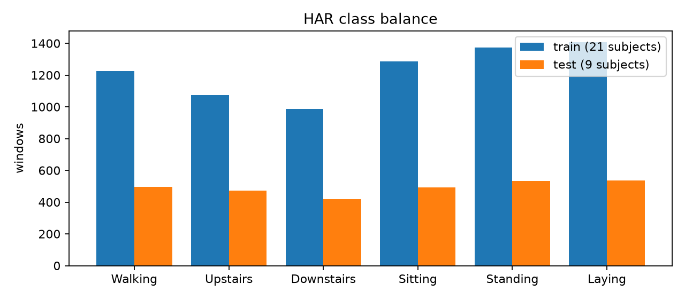
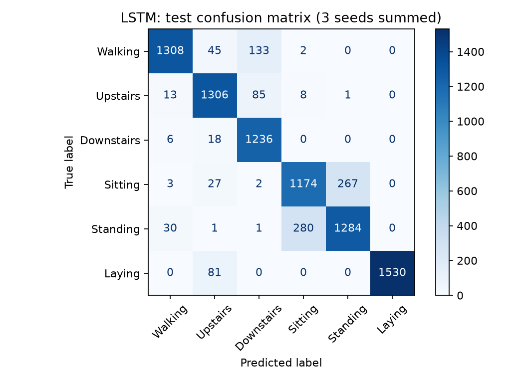
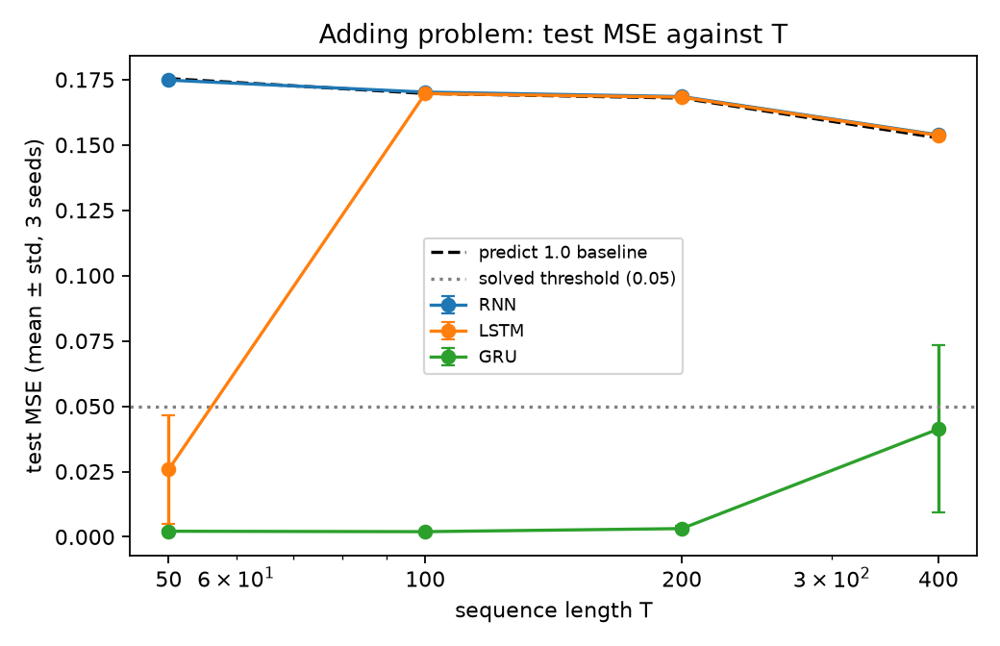
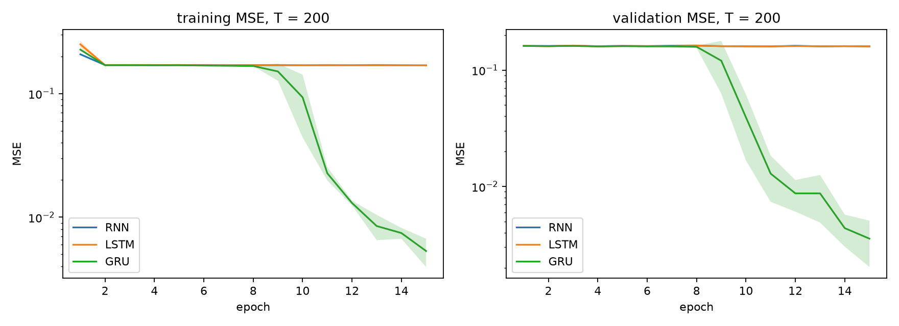
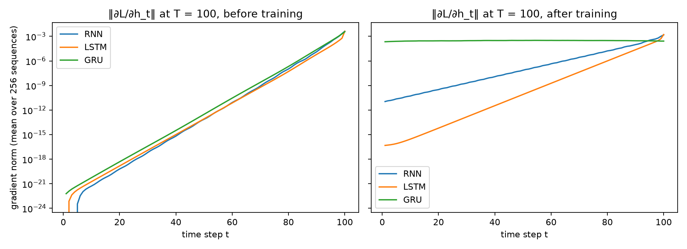
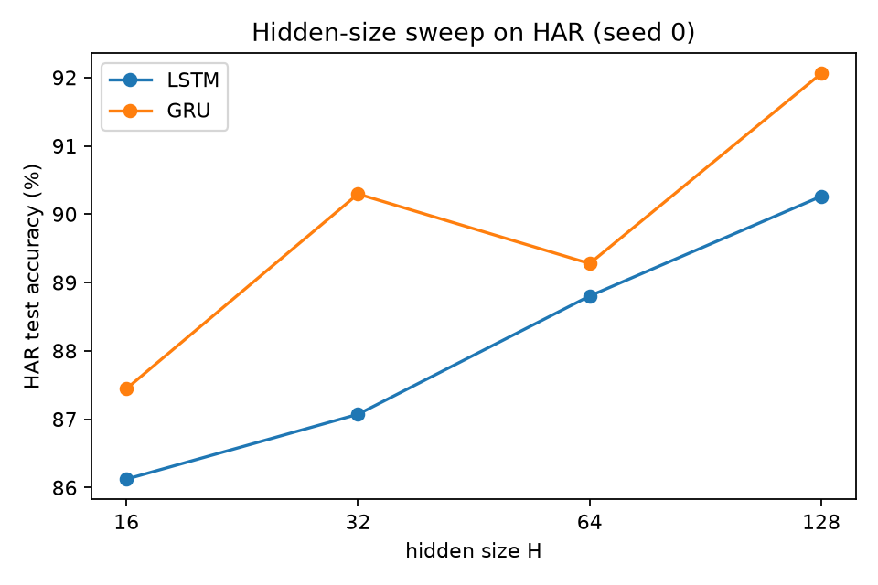
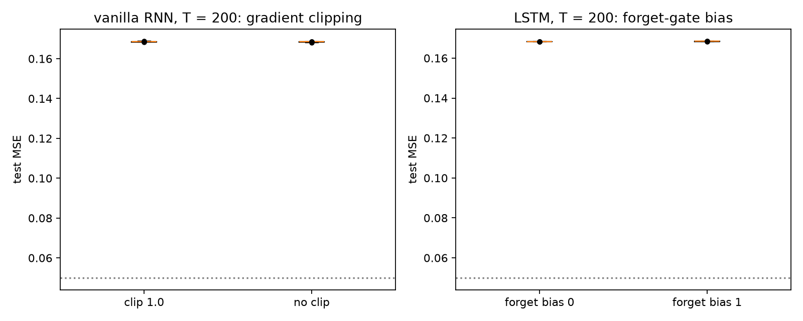

# Problem 1: RNN, LSTM and GRU on Sequences

**Course:** M.Tech AIML, Deep Neural Networks (DNN Programming Assignment-2)
**Student:** Pavansai Podichervu
**Student ID:** 2026AJ05432
**Status:** DRAFT. Problem 1 only. Figures and tables are taken from the project outputs. Items marked [NEEDS VERIFICATION] are not confirmed by the project files.

## 1. Problem objective

The problem asks for three things. First, implement vanilla RNN, LSTM and GRU cells from their equations and check each against the PyTorch layer within 1e-5. Second, compare the three models on real sensor sequences (UCI HAR, 128 steps × 9 channels, 6 classes) and on a synthetic long-memory task (the adding problem), where the sequence length T is controlled. Third, use the results to show why gated cells exist, including a gradient analysis, a hidden-size sweep, and a student-specific ablation.

## 2. Dataset and preprocessing

**UCI HAR.** Official train split (7352 windows, 21 subjects) and test split (2947 windows, 9 subjects). The 9 channels are body_acc x/y/z, body_gyro x/y/z and total_acc x/y/z. Labels are 1 to 6 in the files, shifted to 0 to 5 in code (Walking, Walking Upstairs, Walking Downstairs, Sitting, Standing, Laying).

**Subject-wise validation split.** For each seed s, 4 of the 21 training subjects are drawn with `np.random.default_rng(s).choice(subjects, 4, replace=False)`. Validation subjects were [8, 17, 25, 21] for seed 0, [25, 16, 29, 15] for seed 1 and [11, 25, 5, 7] for seed 2. Training windows were 5886, 5905 and 6017, and validation windows were 1466, 1447 and 1335. Asserts confirm no subject leakage into validation or test.

**Normalization.** Per-channel mean and standard deviation are computed on the training part only and applied to validation and test.

**Adding problem.** The generator is the one given in the brief. Each sequence has a random value channel and a marker channel with exactly two markers, one in each half. The target is the sum of the two marked values. Training uses 10,000 sequences (seed 0), validation 1,000 (seed 1) and test 1,000 (seed 2), for each T in {50, 100, 200, 400}. A generator test asserts the marker structure and the target definition.

**Class balance.** Figure 1 shows the class counts for the 21-subject training file (7352 windows) and the 9-subject test file (2947 windows). Walking Downstairs has the fewest training windows (986) and Laying the most (1407).

{w=4.6}

## 3. Model architectures and experimental setup

**Cells from scratch.** `MyRNNCell`, `MyLSTMCell` and `MyGRUCell` use only matrix operations. Gate order follows PyTorch: LSTM (i, f, g, o), GRU (r, z, n). The GRU candidate is n = tanh(W_in x + b_in + r ⊙ (W_hn h + b_hn)).

**Verification.** Weights are copied from `nn.RNN`, `nn.LSTM` and `nn.GRU` into the cells. On a random batch (B = 32, T = 128, d = 9, h = 64) the maximum absolute differences are 2.68e-07 (RNN output), 5.96e-08 (LSTM output) and 9.69e-08 (GRU output). All are below 1e-5.

**Parameter counts (d = 9, h = 64).** One bias vector per gate block gives 4,736 (RNN), 18,944 (LSTM) and 14,208 (GRU). PyTorch and my cells keep two bias vectors, giving 4,800, 19,200 and 14,400. The difference is exactly one extra bias vector per gate block (h, 4h and 3h).

**Classifier.** The recurrent layer is the library layer (`nn.RNN`, `nn.LSTM` or `nn.GRU`). The output is the last hidden state, followed by a linear head. Total parameters include the head: 390 for the 6-class HAR head and 65 for the 1-output adding head.

**Training configuration (all main runs).** Hidden size H = 64, Adam with lr 1e-3, batch size 64, gradient-norm clipping at 1.0, seeds 0, 1 and 2. HAR uses 30 epochs and the adding problem uses 15 epochs, the same for all three models. Model selection keeps the epoch with the lowest validation loss, and test metrics are computed once with those weights. Training ran on CPU (no CUDA available).

## 4. HAR results: RNN, LSTM, GRU

**Table 1. HAR test results, mean ± sample std over 3 seeds (H = 64, 30 epochs).**

| Model | Params (total) | Test accuracy (%) | Test macro-F1 | Val macro-F1 (mean) | Sec/epoch (mean) |
|---|---|---|---|---|---|
| RNN | 5,190 | 85.04 ± 0.34 | 0.8495 ± 0.0009 | 0.8682 | 0.50 |
| LSTM | 19,590 | 88.66 ± 0.13 | 0.8867 ± 0.0020 | 0.9129 | 1.39 |
| GRU | 14,790 | 88.71 ± 0.66 | 0.8863 ± 0.0066 | 0.9116 | 1.14 |

**Table 2. Per-seed HAR test accuracy (%).**

| Model | Seed 0 | Seed 1 | Seed 2 |
|---|---|---|---|
| RNN | 85.41 | 84.73 | 84.97 |
| LSTM | 88.80 | 88.60 | 88.56 |
| GRU | 89.28 | 88.87 | 87.99 |

Both gated models outperform the vanilla RNN by about 3.6 to 3.7 percentage points. LSTM and GRU are within 0.05 percentage points of each other on mean accuracy, which is well inside their spread. By validation macro-F1 the best model is LSTM (0.9129 against 0.9116 for GRU). By test accuracy the best mean is GRU (88.71 against 88.66). By test macro-F1 LSTM is marginally higher (0.8867 against 0.8863). The ranking depends on the metric, so the two models should be reported as tied.

**Figure 2. Confusion matrix of the best HAR model (LSTM, test set, 3 seeds summed).** Rows are true labels and columns are predictions. Source: problem1/figures/har_confusion_best.png.

{w=3.3}

The largest errors are Sitting and Standing (267 Sitting predicted as Standing and 280 Standing predicted as Sitting). Other notable errors are Walking predicted as Walking Downstairs (133) and Walking Upstairs predicted as Walking Downstairs (85). Laying is almost always correct, with 81 Laying windows predicted as Walking Upstairs.

**HAR training and validation curves: [NEEDS VERIFICATION].** The per-epoch training and validation histories were kept in memory during the run but were not saved to any file, and the notebook does not plot them. No HAR learning-curve figure exists in the project, so none is included here.

## 5. Adding problem results

**Table 3. Adding problem: test MSE, mean ± sample std over 3 seeds, and number of solved runs (MSE < 0.05).**

| T | Constant-1.0 baseline | RNN | LSTM | GRU |
|---|---|---|---|---|
| 50 | 0.1754 | 0.1748 ± 0.0001 (0/3) | 0.0258 ± 0.0207 (3/3) | 0.0021 ± 0.0007 (3/3) |
| 100 | 0.1697 | 0.1702 ± 0.0003 (0/3) | 0.1697 ± 0.0003 (0/3) | 0.0020 ± 0.0001 (3/3) |
| 200 | 0.1679 | 0.1685 ± 0.0003 (0/3) | 0.1683 ± 0.0001 (0/3) | 0.0032 ± 0.0009 (3/3) |
| 400 | 0.1527 | 0.1539 ± 0.0005 (0/3) | 0.1536 ± 0.0001 (0/3) | 0.0413 ± 0.0321 (2/3) |

The constant baselines are the test MSE of predicting 1.0 on each test set. The brief quotes about 0.167. The population value is 1/6 ≈ 0.1667 (E[y] = 1, Var[y] = 1/6), and the per-T values differ because each is computed on one finite 1000-sample test set. Figure 3 plots these numbers.

**Figure 3. Test MSE against sequence length T (mean ± std over 3 seeds).** Dashed line: constant-prediction baseline. Dotted line: solved threshold 0.05. Source: problem1/figures/adding_mse_vs_T.png.

{w=4.6}

**Figure 4. Adding problem learning curves at T = 200 (mean ± std over 3 seeds, log scale).** Left: training MSE. Right: validation MSE. Source: problem1/figures/adding_learning_curves_T200.png.

{w=5.4}

At T = 200 the GRU training and validation MSE fall from about 0.16 to about 0.005 and 0.004 by epoch 15, with the sharpest drop between epochs 8 and 11. The RNN and LSTM curves stay near 0.16 to 0.17 for all 15 epochs. These values are read from the plot, since per-epoch numbers are not stored.

## 6. Training curves and gradient analysis

**Setup.** The gradient profile is measured at T = 100 on 256 held-out sequences (seed 3). For each time step t it reports the L2 norm of ∂L/∂h_t, averaged over sequences. "Before" uses the untrained seed-0 model at T = 100. "After" uses the trained seed-0 model. The profile is computed on the from-scratch unrolled cells with library weights copied in, and the notebook asserts that these reproduce the trained library layer within 1e-5.

**Figure 5. Gradient norm ‖∂L/∂h_t‖ against time step t at T = 100 (log scale), before and after training.** Source: problem1/figures/grad_norm_vs_t_T100.png.

{w=5.4}

**Measured after-training values** (notebook output):

| Model | Ratio \|grad\| at t=1 ÷ \|grad\| at t=T | \|grad\| at t=T |
|---|---|---|
| RNN | 7.23e-09 | 1.519e-03 |
| LSTM | 2.89e-14 | 1.679e-03 |
| GRU | 0.833 | 2.65e-04 |

**Observations from Figure 5.** After training, the GRU gradient is nearly flat across time steps, so early inputs still receive gradient. The RNN and LSTM gradients fall by roughly 9 and 14 orders of magnitude, respectively, from t = T back to t = 1 (ratios 7.23e-09 and 2.89e-14). This matches the test results: GRU is solved at all lengths except one seed at T = 400, while RNN and LSTM stay at the baseline for T ≥ 100.

**Before-training values: [NEEDS VERIFICATION].** The before-training profile is plotted but its numbers were not printed or saved. Visually all three curves are nearly parallel and rise from very small values at early steps to about 1e-3 at t = 100. The RNN and LSTM curves begin at later t, which probably means their early values are zero or below the plot range. The plot does not confirm which.

## 7. Hidden-size experiment

**Setup.** LSTM and GRU on HAR with H ∈ {16, 32, 64, 128}, 30 epochs, one seed (seed 0). The H = 64 point is the seed-0 main run. Results are from one seed only, so treat them as indicative.

**Table 4. Hidden-size sweep (HAR, seed 0).**

| Model | H | Params (total) | Test accuracy (%) | Sec/epoch |
|---|---|---|---|---|
| LSTM | 16 | 1,830 | 86.12 | 0.62 |
| LSTM | 32 | 5,702 | 87.07 | 0.81 |
| LSTM | 64 | 19,590 | 88.80 | 1.38 |
| LSTM | 128 | 71,942 | 90.26 | 2.27 |
| GRU | 16 | 1,398 | 87.44 | 0.66 |
| GRU | 32 | 4,326 | 90.30 | 0.76 |
| GRU | 64 | 14,790 | 89.28 | 1.14 |
| GRU | 128 | 54,150 | 92.06 | 1.85 |

**Figure 6. HAR test accuracy against hidden size H (seed 0).** Source: problem1/figures/hidden_sweep_har.png.

{w=3.6}

LSTM accuracy rises steadily with H, from 86.12% to 90.26%, while parameters grow about 39 times. GRU is not monotonic: it peaks at H = 128 (92.06%) but dips at H = 64 (89.28%) below H = 32 (90.30%). With one seed, a dip of about one point cannot be separated from seed noise. The 3-seed spread at H = 64 was 0.13 points (LSTM) and 0.66 points (GRU).

## 8. Student-specific ablation

**Assigned variant.** The brief assigns the ablation by the last digit of the student ID. The ID 2026AJ05432 ends in 2, which is even, so the assigned ablation is gradient clipping (norm 1.0 against none) for the vanilla RNN at T = 200. The notebook runs both variants because the ID was not available to it. The LSTM forget-bias ablation (bias 0 against 1) is also reported below for completeness, but it is not the assigned variant.

**Table 5. T = 200 ablations (test MSE, mean ± std over 3 seeds; solved runs out of 3).**

| Ablation | Condition | Test MSE | Solved |
|---|---|---|---|
| RNN (assigned) | Clip 1.0 | 0.1685 ± 0.0003 | 0/3 |
| RNN (assigned) | No clip | 0.1684 ± 0.0003 | 0/3 |
| LSTM (not assigned) | Forget bias 0 | 0.1683 ± 0.0001 | 0/3 |
| LSTM (not assigned) | Forget bias 1 | 0.1684 ± 0.0001 | 0/3 |

**Figure 7. T = 200 ablation results.** Left: RNN with and without gradient clipping. Right: LSTM with forget-gate bias 0 and 1. Dotted line: solved threshold 0.05. Source: problem1/figures/ablation_T200.png.

{w=5.2}

**Observation.** Neither condition solves the task. All four conditions sit at about 0.168, close to the constant baseline of 0.1679. Clipping changes the RNN test MSE by 0.0001, which is within seed spread. The result shows that gradient clipping alone does not help the vanilla RNN at T = 200 under this 15-epoch budget. It does not show that clipping is useless in general, since the notebook tested only one budget and one learning rate.

## 9. Results interpretation and discussion

**Gated cells versus vanilla RNN.** On HAR, LSTM and GRU reach 88.7% mean test accuracy against 85.0% for the vanilla RNN, and the gap is far larger than the seed spread. On the adding problem, the RNN stays at the constant baseline for every T, while GRU is solved at every T for at least two of three seeds. The gradient profile explains this: after training, the RNN's gradient at early time steps is about 1e-9 of its value at the last step, so the early inputs barely influence learning.

**LSTM versus GRU.** The two gated models are tied on HAR within noise. On the adding problem, GRU is solved at all four lengths, while LSTM is solved only at T = 50. The gradient profile shows the same ordering: GRU keeps a nearly flat gradient profile, while LSTM's early-step gradient is about 3e-14 of its last-step value.

**Where models fail as T grows.** The RNN is at baseline at all T. The LSTM is solved at T = 50 but at baseline from T = 100 with this budget. GRU is solved at T = 50 to 200 and degrades at T = 400 (mean MSE 0.041, with one seed at 0.078). Whether LSTM would succeed at T ≥ 100 with more epochs is not tested here.

**Accuracy, parameters and time.** RNN has the fewest parameters (5,190) and the shortest epoch (0.50 s), but is about 3.7 percentage points less accurate. GRU matches LSTM's accuracy with 25% fewer parameters (14,790 against 19,590) and about 18% less time per epoch (1.14 s against 1.39 s), measured on CPU during training.

**Limitations.** Each number comes from 3 seeds, and the hidden-size sweep uses one seed. HAR training curves and before-training gradient values were not saved. Training used a short budget (30 HAR epochs, 15 adding epochs) on CPU, and results may change with longer training. The validation split for the classical SVM comparison differs from the RNN validation split, so the classical numbers are not directly comparable.

## 10. Wearable activity recognition recommendation

*This section is a recommendation drawn from the tables above. It is not a measured result.*

For a battery-powered wearable, I would choose the **GRU**. On HAR, GRU matches LSTM's accuracy (88.71% against 88.66%) with fewer parameters (14,790 against 19,590) and less time per epoch (1.14 s against 1.39 s). On the adding problem, GRU is the only model that learns long-range dependencies at all tested lengths. The RNN is the cheapest option, but its 3.7-point accuracy deficit is large for a health or safety application.

Two caveats apply. First, the time and parameter figures are for CPU training, and inference energy on a wearable processor was not measured. Second, no on-device memory or latency budget was tested, so the H = 64 model's suitability for a specific wearable is unverified. The hidden-size sweep suggests that GRU at H = 32 (4,326 parameters) reached 90.30% on seed 0, but this is a single seed and needs confirmation before it is used. [NEEDS VERIFICATION]

## 11. Conclusion

From-scratch RNN, LSTM and GRU cells match the PyTorch layers within 1e-5, and their parameter counts reconcile with PyTorch's by the expected bias term. On HAR, LSTM and GRU outperform the vanilla RNN by about 3.7 points and are tied with each other. On the adding problem, GRU is the only architecture that solves the task at most lengths, and the gradient analysis shows why: its gradient reaches early time steps, while the RNN's and LSTM's do not. Gradient clipping does not rescue the RNN at T = 200 in this setup. The results are based on 3 seeds and a short training budget. A longer budget and more seeds for the sweep and ablation would strengthen the conclusions.
